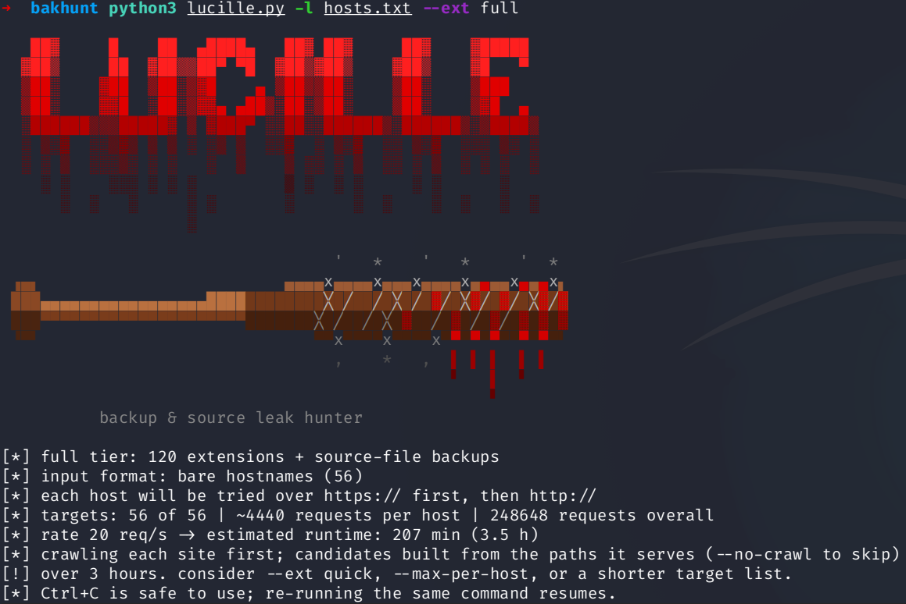
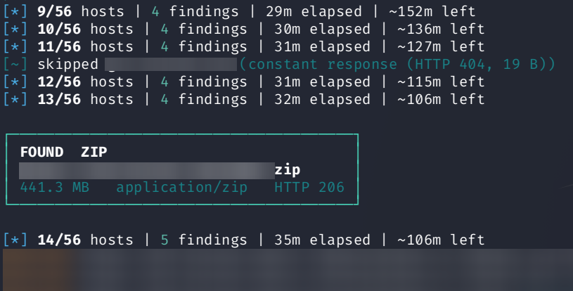

# Lucille

Backup-file and source-leak hunter — a single, zero-dependency Python file that
takes a list of web hosts and finds exposed backup archives, database dumps and
source-code leaks (`backup.zip`, `db.sql`, `config.php.bak`, `.git/HEAD`,
`.env`, and the like).

<p align="center">
  
</p>

Its real job is cutting out false positives. Most servers answer `200 OK` even
for files that do not exist, so a naive scanner drowns you in fake hits. Lucille
calibrates each host, reads the actual bytes of every response (not the
`Content-Type` header, which lies), and only reports files that are really there.

## Why it finds what other scanners miss

- **It reads the site first.** Before guessing, Lucille crawls the target
  (links, `robots.txt`, `sitemap.xml`, JS bundles) and turns the paths it
  actually serves into candidates — `app.js` → `app.js.bak`, `app.js.map`;
  `/admin/` → `/admin/backup.zip`. Guesses become evidence-based.
- **It derives the brand from the page.** On an IP-only target with no hostname
  (`10.0.0.9:3000`), it reads the site's name from the title and logo
  (`KARAKAYA`) and tries `karakaya.zip`, `krky.sql`, and so on.
- **It never writes off a quiet host.** An API server that answers `404` at `/`
  looks dead but may still serve `/.env` or `/.git/HEAD`, so those fixed
  high-value paths are always tried.
- **It confirms with magic bytes.** A real ZIP, gzip, SQLite DB or git repo is
  verified by its signature, not by a header a server can fake.

## Install

```bash
git clone https://github.com/hazartaspinar/Lucille.git
cd lucille
python3 lucille.py --help
```

Optional — make it callable from anywhere on Linux:

```bash
chmod +x lucille.py
sudo ln -sf "$(pwd)/lucille.py" /usr/local/bin/lucille
```

No dependencies. Python 3 standard library only. Works on Linux and Windows.

## Quick start

A file with one host per line (bare hostnames or full URLs, httpx output works
as-is):

```
example.com
api.example.com
https://shop.example.com
```

```bash
# wide sweep, highest hit rate, ~24 requests per host
lucille -l hosts.txt --no-derive --no-common -o kritik.jsonl

# everyday scan
lucille -l hosts.txt --ext quick -o results.jsonl

# one interesting host, deep
lucille -l one.txt --ext full --source -o deep.jsonl
```

## Reading the results

Findings print as they are found and stream to the output file live, so you can
`grep` mid-scan. A confirmed hit gets a box; everything else is one line.

<p align="center">
  
</p>

- **HIGH** — magic bytes confirmed. This is a real file. Look at it.
- **MEDIUM** — content type matches but the signature was not recognised. Check by hand.
- **LOW** — weak signal, hidden unless you pass `--all`.

Each line of the output file is one JSON object:

```json
{"url": "https://example.com/backup.zip", "status": 200, "type": "zip",
 "confidence": "high", "content_length": "5242880"}
```

Pull just the ones that matter:

```bash
grep '"confidence":"high"' results.jsonl
grep -iE 'env-file|git-head|credentials|private-key|sql-dump' results.jsonl
```

## Scan depth

| Flags | Paths per host | Use for |
|-------|---------------:|---------|
| `--no-derive --no-common` | 24 | Fastest. Fixed high-value paths (`.env`, `.git/HEAD`, `id_rsa`). |
| `--ext quick` (default) | ~400 | Everyday use. |
| `--ext normal` | ~1400 | Wider extension coverage. |
| `--ext full` | ~4000 | Everything. Short lists only. |

The crawl runs on top of these and adds candidates built from what the site
serves. A good workflow: the fast pass on everything, then `--ext full` on the
hosts that looked interesting.

## Options

```
Target
  -l, --list FILE        Host list (bare hostnames or full URLs)
  -p, --paths FILE       Use your own path list (disables all generation)

Scope
      --ext quick|normal|full   Extension tier (default: quick)
      --source                  Also try source backups (config.php.bak, index.php~)
      --no-derive               Do not build names from the hostname
      --no-common               Do not try generic names (backup, db, www)
      --no-tr                   Do not try Turkish names (yedek, arsiv)
      --no-crawl                Do not read the site first
      --crawl-depth N           How many link hops to follow (default 2)
      --max-per-host N          Cap requests per host

Speed
  -r, --rate N           Total requests per second (default: 20)
  -t, --threads N        Concurrent hosts (default: 10)
      --timeout N        Request timeout in seconds (default: 8)

Output
  -o, --output FILE      Results file, JSONL
      --all              Include low-confidence findings
      --log FILE         Write every attempt (status + URL) to a file
  -v, --verbose          Print every path as it is tried
      --no-color / --no-bell / -s   Quiet the output

Resume
      (automatic)        Ctrl+C is safe; re-run the same command to continue
      --restart          Ignore saved state and start over

Proxy
      --proxy URL        Route through one proxy ({SESSION} = sticky per host)
      --proxy-file FILE  One proxy per line, picked per host

Info
      --dry-run          Print the paths that would be tried, send nothing
      --list-ext         Print every extension and name generated
  -V, --version          Print the version
  -h, --help / -tr       Help (English / Turkish)
```

## How it works

For each host, Lucille:

1. Requests `/` and two random filenames to learn the host's "not found" reply.
2. Crawls the site briefly and derives candidates from the real paths and the brand name.
3. Generates further candidates from the hostname and its wordlists.
4. Requests the first 2 KB of each candidate (ranged, so a huge dump never floods your bandwidth).
5. Drops anything matching the calibration reply, then checks the magic bytes of what is left.
6. Reports only files whose content is confirmed.

## Legal

Only use this against systems you own or have written permission to test.
Scanning hosts without authorisation is illegal in most places. You are
responsible for how you use it.

## License

MIT
